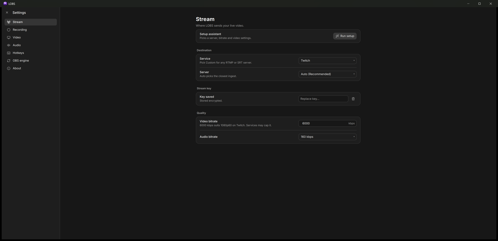

# LOBS

A streaming and recording app for Windows, built on OBS Studio's engine with a new editor.
LOBS installs on its own; OBS doesn't need to be installed.

## What's different from OBS

### Add a source once, use it everywhere

In OBS, a camera with a different crop or filter in another scene usually means adding the
camera again. In LOBS you add each input once in **Sources**, then place it in any scene. Each
placement (a layer) has its own position, size, crop, filters and visibility. Any of those can
be linked between scenes so they stay in sync, and the Inspector shows which parts are shared.

### Graphic tools on the canvas

Text, rectangles, ellipses, arrows, a freehand pencil and a laser pointer, right under the
preview. Shapes are vector layers that stay sharp at any size. The laser draws a fading trail
on the output without adding anything to the scene. Text works like a design tool: drag to set
the size, then type.

### Crop on the canvas, round corners on any layer

Drag crop handles on the layer, or crop to 16:9, 4:3, 1:1 or 9:16 in one click. Cropping keeps
the layer's scale instead of stretching what's left. Corner radius works on every layer, so a
square crop plus fully round corners turns a webcam into a circle without a mask image or
custom filter.

### Layers that behave like a design tool

Drag to reorder, drop into a group, or hold one layer over another to group them. Ctrl+] and
Ctrl+[ change the order. Double-clicking on the canvas steps into nested groups one level at a
time. Every scene has a background that can be hidden but not deleted by accident.

### Transitions with a live preview

Fade, cut, swipe, slide, fade to color, luma wipe and stinger, with an A to B preview that
replays as you change settings. Transitions are saved with the show.

### A setup assistant

On first run, LOBS asks what you're doing and where you stream, finds the fastest server,
runs a 10 second test stream (nothing goes live on Twitch), and recommends bitrate,
resolution and frame rate for your connection and encoder.

### Also

- Twitch Chat and Stream info panels, with zoom (Ctrl + / Ctrl −).
- An asset library for the project's files: folders, search, copy and paste, drag to the canvas.
- Projectors: the program or a single scene, full screen on any monitor or in a window.
- Undo history for every edit, scrubbable number fields, a color picker with an eyedropper
  and saved swatches, and recently used fonts.
- Replay buffer, virtual camera, global hotkeys, and OBS scene collection import.
- The OBS engine updates from OBS's official releases, verified, with automatic rollback.

## Install

Download `LOBS-Setup-<version>.exe` from [Releases](https://github.com/LoganAffleck/lobs/releases).

The installer isn't code-signed yet, so Windows SmartScreen may show "Windows protected your
PC". Choose **More info**, then **Run anyway**.

## Status

Early preview (v0.1). Expect rough edges.

## Building

See [BUILDING.md](BUILDING.md).

## License

GPL-2.0-or-later, see [LICENSE](LICENSE). Third-party components are listed in
[THIRD_PARTY_NOTICES.md](THIRD_PARTY_NOTICES.md).
