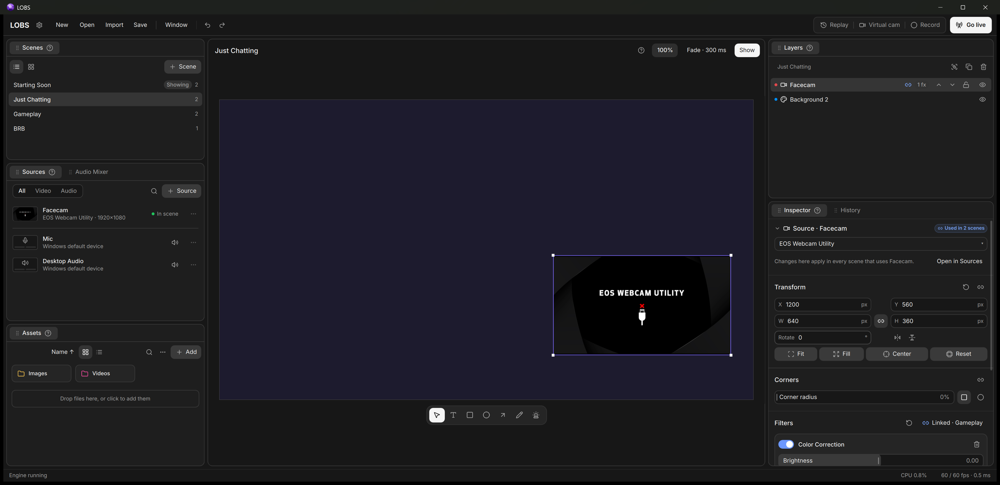
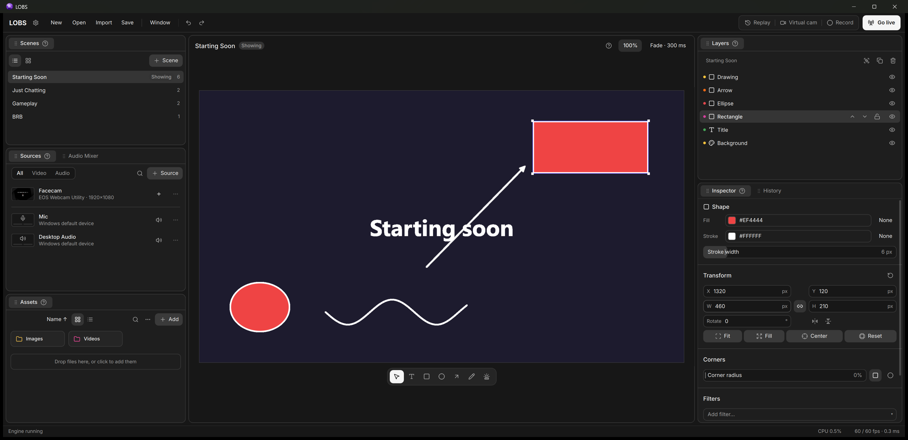
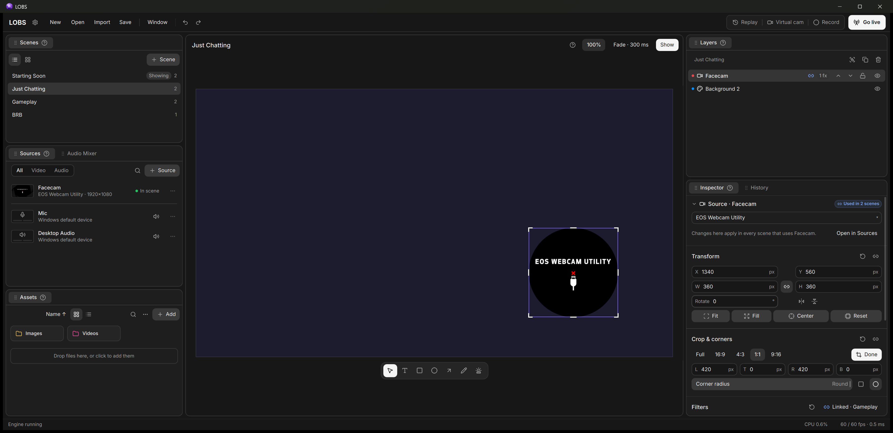
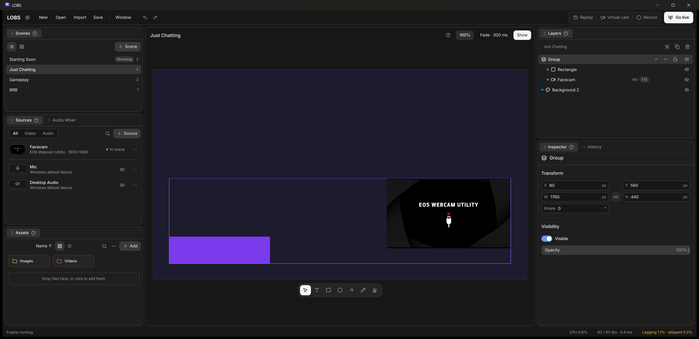
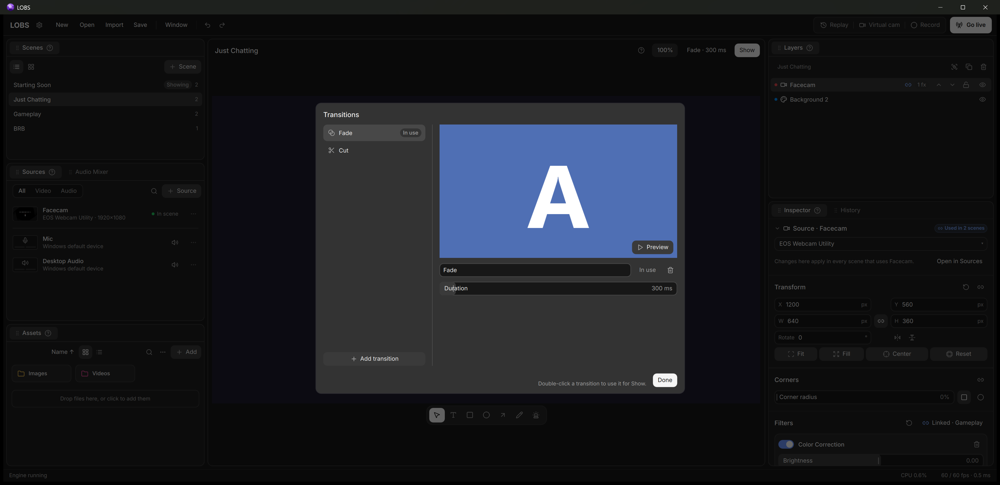
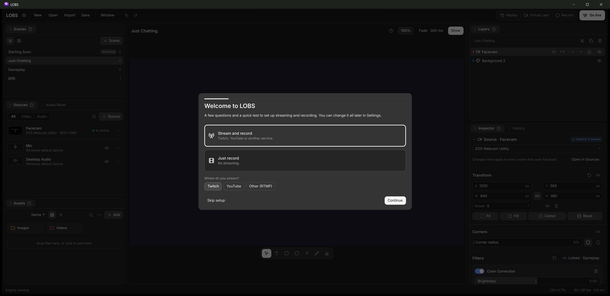

# LOBS

Logan's OBS

A streaming and recording app for Windows, built on OBS Studio's engine. Installs on its own,
no OBS required.

## Features

**One source, many scenes.** Add a camera or capture once, then place it in any scene. Each
placement has its own size, crop, filters and visibility, or links them across scenes.

**Graphic tools.** Text, rectangles, ellipses, arrows, pencil and a laser pointer. Shapes stay
sharp at any size. The laser shows on stream but isn't added to the scene.

**Crop and corners.** Crop by dragging handles on the canvas, or pick 16:9, 4:3, 1:1 or 9:16.
Round the corners of any layer, up to a circle.

**Layers.** Drag to reorder or group. Ctrl+] and Ctrl+[ change the order. Double-click steps
into groups.

**Transitions.** Fade, cut, swipe, slide, fade to color, luma wipe and stinger, with a live
preview.

**Setup assistant.** Picks a server, tests your connection and suggests bitrate and
resolution.

**Also:** Twitch chat and stream info panels, an asset library, projectors, undo history,
replay buffer, virtual camera, global hotkeys and OBS scene collection import.

## Install

Download the installer from [Releases](https://github.com/LoganAffleck/lobs/releases). It
isn't code-signed yet, so if SmartScreen appears, choose **More info**, then **Run anyway**.

v0.1 is an early preview.

## Build

See [BUILDING.md](BUILDING.md).

## License

GPL-2.0-or-later ([LICENSE](LICENSE)). Third-party licenses: [THIRD_PARTY_NOTICES.md](THIRD_PARTY_NOTICES.md).
